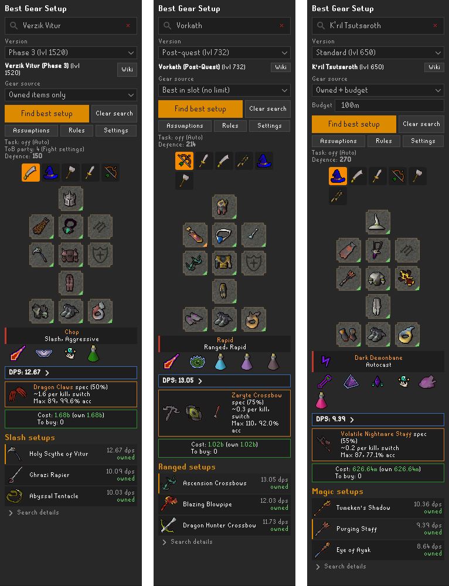
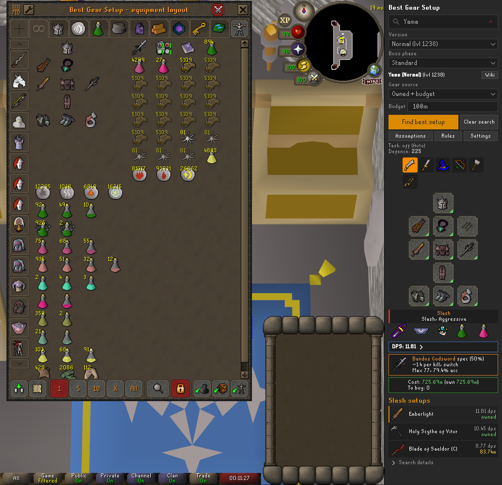
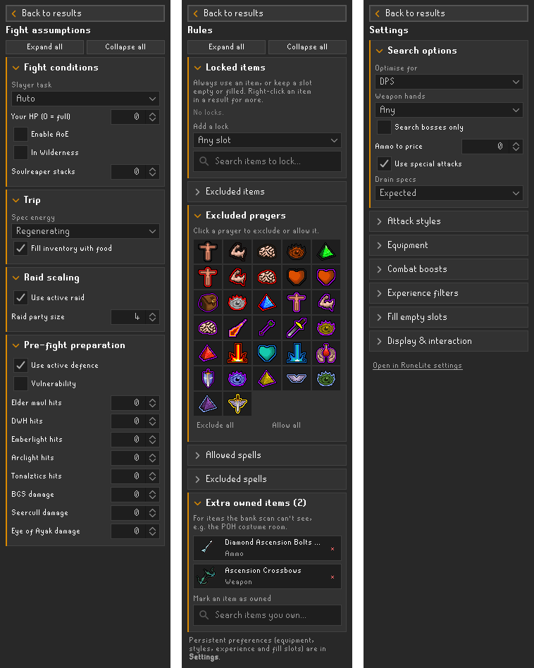

# Best Gear Setup

Find the best gear for any monster or boss without leaving RuneLite. Stick to what you own, shop within a
budget, or go straight to best in slot.

## Getting started

1. Install **Best Gear Setup** from the Plugin Hub.
2. Log in and open your bank once so the plugin can see what you own.
3. Open the **Best Gear Setup** sidebar panel, or right-click an NPC and choose **Best setup**.
4. Search for a monster, pick a mode and click **Find best setup**.

Right-click an item in a result to lock it, exclude it or mark it as owned (the special attack weapon can be
excluded or marked as owned too), or a prayer, spell or potion to exclude it, or add these rules from the
**Rules** panel.

## Features

- **Any monster or boss**, with versions and phases (Vorkath, Verzik, Yama and so on) in one search.
- **Four modes:** *Owned items only*, *Inventory + equipped only*, *Owned + budget* (e.g. `50m`) and
  *Best in slot*. **No GE** limits budget and best-in-slot searches to items a shop stocks, at their shop price
  (Tokkul, tickets and other shop currencies cost no coins).
- **A result per attack style** with DPS, max hit, accuracy, time to kill, kills per hour and the cost of
  anything you'd need to buy, plus the next-best alternatives.
- **Allowed and Excluded spells** in Rules let you limit searches to the spells you choose or exclude spells.
  Spells can be autocast or cast by hand with any weapon (spells that need their own staff, such as Iban Blast,
  only with it), and powered staves and salamanders can still compete.
- **Runes per kill** estimate attack and support rune use, including runes supplied by your staff or tome,
  rune-saving weapons, special attacks and your thrall tier.
- **Knows your account:** owned items, levels, prayers, Slayer task and diaries, remembered per profile. With
  [Dude, Where's My Stuff?](https://runelite.net/plugin-hub/show/dude-wheres-my-stuff) enabled, gear in your STASH
  units, POH, deathbanks and other storage it tracks counts too.
- **Potions, prayers, thralls and special attacks** are all counted, with the best spec weapon suggested and
  the overhead protection prayer to use, with advice from the Wiki's strategy pages.
- **Trip supplies** for your Kills per trip: combat time, prayer use, boost and prayer restore bottles, an
  antipoison or antivenom when the target poisons, and food for the free inventory slots.
- **Bank gear layout and highlights** lay out the setup's gear beside its inventory, packed as you'd carry it,
  ready to withdraw. The layout stays open the next time you open the bank.
- **Encounter rules are enforced:** damage caps, immunities, dragonfire protection, raid scaling and
  required Slayer gear.

Everything else is in the sidebar too. **Assumptions** sets your HP, Slayer task, AoE, Wilderness, the trip
(kills, spec energy and food), raid scaling and pre-fight defence reductions. **Rules** lists your locks,
excluded items and prayers, spell rules and extra owned items, with a search to add more. **Settings** covers
search options, attack styles, equipment, experience filters, fill empty slots, combat boosts and display
(the NPC right-click option, highlights and the panel theme).

## Good to know

- Results are expected DPS, not a simulated fight: switch timing, overkill, movement and line of sight
  aren't modelled. See [COMBAT_AUDIT.md](COMBAT_AUDIT.md) for known gaps and
  [docs/mechanics.md](docs/mechanics.md) for how everything is worked out.
- All data is bundled and the search runs locally, so the plugin makes no network requests. Prices come
  from RuneLite.

## Support

[Join the Discord community](https://discord.gg/gxFXvnUrUs) for setup help, gear discussions, FAQs and
feature requests.

Report bugs on the [issue tracker](https://github.com/aknaus1/best-gear-setup/issues). If a result looks
wrong, include the monster, version, mode and the text under **Search details**, but not your account name
or whole bank.

## License

Code is under the [BSD 2-Clause licence](LICENSE). Monster, equipment and immunity data comes from the
[Old School RuneScape Wiki](https://oldschool.runescape.wiki/) contributors under
[CC BY-NC-SA 3.0](https://creativecommons.org/licenses/by-nc-sa/3.0/); see
[THIRD_PARTY_NOTICES.md](THIRD_PARTY_NOTICES.md). Not affiliated with Jagex or the OSRS Wiki.
To build from source, see [CONTRIBUTING.md](CONTRIBUTING.md).
